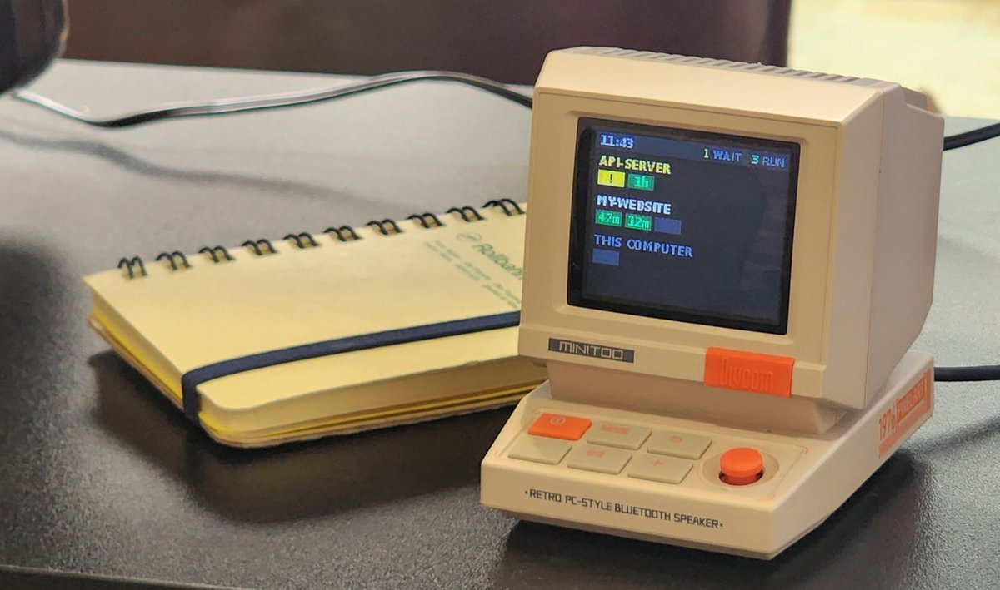
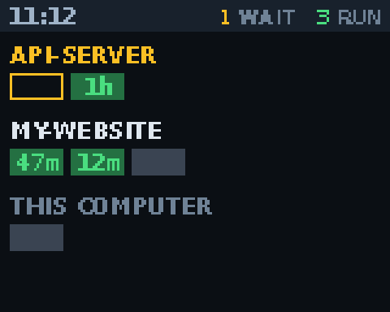
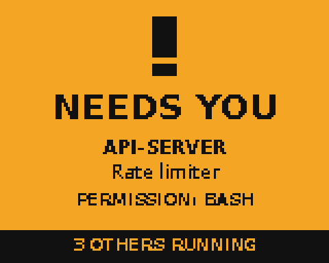
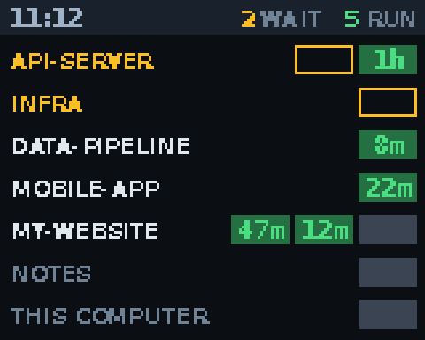
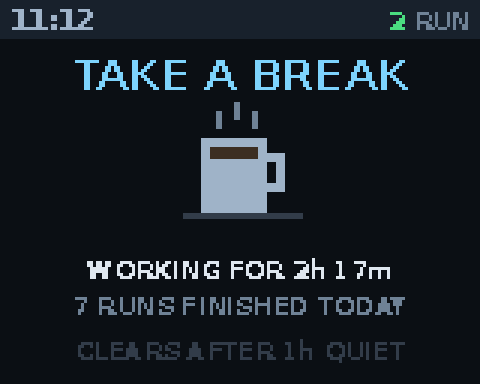

# MiniToo Claude Code monitor

A small status light for [Claude Code](https://claude.com/claude-code) on the 160×128 screen of a
[Divoom MiniToo](https://divoom.com/products/minitoo) Bluetooth speaker. Every running session gets a
glowing green square with its running time, grouped by project. A session that needs you turns amber
and plays a chime. After a long stretch of work the speaker tells you to take a break.

<p align="center">
  
</p>

<p>
  
  
</p>

> This is a community project. It is not made by, endorsed by or affiliated with Divoom or Anthropic.

## What it shows

| Square | Meaning |
|---|---|
| Green number on a slowly glowing square | Running, with how long it has been running (`47m`, `2h`) |
| Blinking amber block | Waiting for you (a permission prompt or a question) |
| Grey block | Finished; clears after 10 minutes |

- **Grouped like the Claude desktop app.** If you use the desktop app, each session is filed under
  the same project name as the app's sidebar, and sessions opened without a folder show as
  *This computer*. Sessions from a plain terminal use their git repository or folder name.
- **Adapts to space.** Up to three projects get a roomy layout. More projects switch to one compact
  row each, and past seven rows the rest are counted as `+N MORE PROJECTS`.
- **Needs-you alert.** When a session starts waiting, the whole screen turns amber for a few seconds
  with the project, the session title and what it is asking for.
- **Take-a-break screen.** The timer starts with the first job. After 2 h 15 m the screen switches to
  a coffee mug and plays a short footsteps-pour-gulp-"aaah" sound. It clears once no new job has come
  in for an hour. Anything that needs you still takes over the screen.

<p>
  
  
</p>

### Sounds

Played through the MiniToo's own speaker only. Your default audio output is never changed.

| Sound | When |
|---|---|
| [start](docs/sounds/start.mp3) | A session starts, or a finished one starts again |
| [needs-you](docs/sounds/needs-you.mp3) | A session is waiting for you |
| [all-done](docs/sounds/all-done.mp3) | A session finishes |
| [take-a-break](docs/sounds/take-a-break.mp3) | The break screen first appears |

All sounds are synthesized from sine waves and noise by the code in this repo, so there are no
recordings to license.

## Requirements

- Linux with BlueZ and PipeWire or PulseAudio (`bluetoothctl`, `pactl`, `paplay`) and systemd.
- Python 3.9+ with Pillow and numpy. On Debian/Ubuntu: `sudo apt install python3-pil python3-numpy`.
- DejaVu fonts (`fonts-dejavu-core`), installed by default on most distributions.
- A Divoom MiniToo paired and connected over Bluetooth. A Divoom Tiivoo 2 may also work; see
  [Experimental: Tiivoo 2](#experimental-tiivoo-2).

macOS and Windows are not supported yet.

## Install

1. Pair the MiniToo in your Bluetooth settings and connect it.
2. Close the Divoom phone app. The speaker accepts only one control connection, and the monitor
   needs it.
3. Run:

```bash
git clone https://github.com/kryogenica/minitoo-claude-monitor.git
cd minitoo-claude-monitor
python3 install.py
```

The installer:

- copies the program to `~/.local/share/minitoo-monitor`;
- adds a `minitoo` command to `~/.local/bin`;
- adds five hooks to `~/.claude/settings.json`, keeping a backup as `settings.json.before-minitoo`;
- starts a systemd user service that runs whenever you're logged in.

Sessions start showing up from their next prompt.

To remove everything (your config is kept):

```bash
python3 install.py --uninstall
```

## Everyday use

```bash
minitoo status    # what the monitor knows about
minitoo pause     # free the speaker so the Divoom app can connect
minitoo resume    # take it back
minitoo config    # list and change settings (see below)
minitoo break     # see or reset the break timer
journalctl --user -u minitoo-monitor -f
```

## Settings

Change settings with the `minitoo config` command. The monitor applies a change within a second, with
no restart:

```bash
minitoo config                            # list every setting, its value and what it does
minitoo config break_after_minutes 90     # break screen after 1 h 30 m instead of 2 h 15 m
minitoo config break_reset_minutes 30     # a 30-minute pause counts as a break
minitoo config quiet_hours 22 7           # no sounds from 22:00 to 07:00
minitoo config volume 60                  # quieter chimes
minitoo config glow on
minitoo config volume --default           # back to the default
```

Values are checked before they're saved, so a typo gets a clear message instead of a broken
monitor. Settings are stored in `~/.config/minitoo/config.json`, which you can also edit by hand.

| Setting | Default | What it does |
|---|---|---|
| `break_screen` | `true` | Turns the take-a-break screen on or off. |
| `break_after_minutes` | `135` | Minutes from the first job of a stretch until the break screen. |
| `break_reset_minutes` | `60` | Minutes with no new job that end the stretch and clear the break screen. |
| `break_sound` | `coffee` | `coffee` (footsteps, pour, gulp, "aaah") or `chime`. |
| `glow` | `false` | The three-step glow on running squares. See the warning below. |
| `alert_seconds` | `6` | How long the full-screen NEEDS YOU alert stays up. |
| `done_expire_minutes` | `10` | How long finished sessions stay as grey blocks. |
| `stale_expire_hours` | `12` | Drop sessions that haven't reported anything for this long. |
| `no_folder_label` | `This computer` | Project name for sessions opened without a folder. |
| `volume` | `100` | Sound volume, as a percent of the speaker's current level. |
| `quiet_hours` | `[]` | Two hours with no sounds in between, e.g. `22 7`. |
| `sound_start`, `sound_needs_you`, `sound_done`, `sound_break` | `true` | Turn individual sounds off. |
| `mac` | empty | Speaker address. Empty means the first paired device matching `device_names`. |
| `device_names` | `MiniToo,Tiivoo` | Name parts to look for among paired devices, in order of preference. |

### Break timer

```bash
minitoo break          # when the stretch started, when the break screen is due, when it resets
minitoo break reset    # took a real break? clear the timer now
```

The break timer starts with the first job, shows the break screen after `break_after_minutes`, and
resets once no new job has come in for `break_reset_minutes`. A new job means a session starting from
idle, or a finished session starting again.

## Experimental: Tiivoo 2

The [Divoom Tiivoo 2](https://divoom.com/products/divoom-tiivoo-2-photo-album-lyrics-speaker) is
matched too, but **nobody has tested it with this project yet**. The community protocol notes describe
it as running the same firmware as the MiniToo and as "byte-for-byte protocol-identical". Its screen
is *assumed* to be the same 160×128, and the animation upload this project uses hasn't been confirmed
on it.

If you have one:

1. Pair it, close the Divoom app, and install as above. The monitor picks the first paired MiniToo,
   then the first Tiivoo. If you have both, `minitoo config device_names Tiivoo` picks the Tiivoo.
2. Leave `glow` off at first. Run `minitoo send-test` and check that a test screen appears and fits.
3. If the screen freezes, run `minitoo pause` and restart the speaker. See the warnings below.

Please open an issue with what you saw, a photo if you can, so it can be marked as supported or fixed.

The [Divoom Astrotoo](https://divoom.com/products/divoom-astrotoo-smart-pixel-art-desktop-speaker) is
not supported. It has a 480×480 screen and no published protocol notes yet.

## Be careful with the speaker

The MiniToo's screen protocol is undocumented and the firmware is easy to upset:

- **Keep animations small.** An 8-frame, 20 KB animation froze the screen on a loading spinner, and
  the power button stopped responding until the speaker restarted. Single frames, the 2-frame amber
  blink and the 3-frame glow (about 7.5 KB) have been fine. The glow is off by default. If a glow
  upload ever fails, the monitor switches the glow off by itself and backs off for a minute.
- **Only one opcode is used for drawing:** the live animation upload (`0x8B`). The community notes
  this project relies on report that several other commands (`0x40`, `0xA3`, `0xA4`, `0xAD`, `0xAE`)
  and custom icon uploads (`0x3C`) can brick the device. Don't add them.
- If the screen freezes, run `minitoo pause`, then hold the power button for 10–15 seconds.

## How it works

```
Claude Code hooks ──► minitoo.py hook <state> ──► ~/.cache/minitoo/sessions/<id>.json
                                                          │
systemd user service: minitoo.py daemon ◄─────────────────┘
   ├─ reads the Claude desktop app's session records for project names and titles
   ├─ draws the screen with Pillow, sends it as JPEG frames over Bluetooth RFCOMM
   └─ plays chimes on the speaker's own audio output with paplay
```

The hooks only write a small JSON file and return immediately. All Bluetooth work happens in the
background service, so a missing or busy speaker never slows Claude Code down.

Hook mapping: `UserPromptSubmit` and `PreToolUse` mean running, `Notification` means waiting,
`Stop` means finished, and `SessionEnd` removes the session. If you interrupt a turn with Esc,
Claude Code sends no `Stop`, so that session stays "running" until its next prompt or until you close it.

## Credits

The MiniToo's Bluetooth protocol (RFCOMM channel 1, frame format, the `0x8B` animation upload and the
list of dangerous commands) comes from the reverse-engineering notes in
[bugzmanov/divoom-minitoo](https://github.com/bugzmanov/divoom-minitoo). No code from that project is
included.

## License

[MIT](LICENSE)
